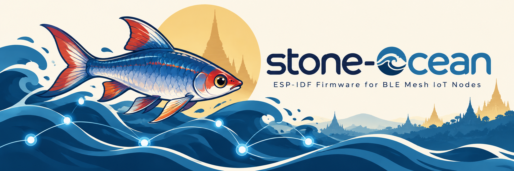

# ESP32 BLE Mesh IoT Node

[](https://github.com/aungkhantmaw64/stone-ocean/actions/workflows/ci.yml)
[](https://docs.espressif.com/projects/esp-idf/en/v5.4.4/esp32/)

Config-driven BLE mesh node firmware for the ESP32-DevKitC. A JSON config
stored in flash says which sensors and actuators are attached. See
[`docs/README.md`](docs/README.md) for how the system is designed, and
[`specs/README.md`](specs/README.md) for requirements and the implementation
plan.

## Toolchain

- **ESP-IDF v5.4.4** (pinned; ESP-BLE-MESH APIs differ between versions)
- Docker image `espressif/idf:v5.4.4`, if ESP-IDF is not installed locally

## Build flavours

| Flavour | Purpose | Build directory |
|---|---|---|
| `hw` | Full firmware with BLE mesh, flashed to a DevKitC | `firmware/build/` |
| `qemu` | Same firmware with Bluetooth and mesh disabled, for Espressif QEMU | `firmware/build-qemu/` |

The boot banner shows the firmware version (`git describe`), the IDF version
and the flavour:

```
I (1392) app_main: mesh_node cd7a159 | IDF v5.4.4 | flavour qemu
```

## Building and running

With ESP-IDF installed and `export.sh` sourced, run from the repository root:

```sh
scripts/build.sh                          # hw build
scripts/build.sh qemu                     # qemu build
scripts/qemu.sh                           # build qemu flavour, boot it in QEMU with the monitor
PORT=/dev/ttyUSB0 scripts/build.sh hw flash monitor
```

`scripts/build.sh [hw|qemu] [idf.py actions...]` passes any actions through to
`idf.py` (default `build`). `PORT` selects the serial port. Quit the monitor
with Ctrl+].

### Using Docker instead of a local ESP-IDF

Run from the repository root. Build output stays owned by your user.

Hardware build:

```sh
docker run --rm -u $(id -u):$(id -g) -e HOME=/tmp -v $PWD:/project -w /project \
  espressif/idf:v5.4.4 scripts/build.sh
```

Boot the QEMU build:

```sh
docker run --rm -it -u $(id -u):$(id -g) -e HOME=/tmp -v $PWD:/project -w /project \
  espressif/idf:v5.4.4 scripts/qemu.sh
```

Flash and monitor a DevKitC (find the port with `ls /dev/ttyUSB*`):

```sh
PORT=/dev/ttyUSB0
docker run --rm -it -u $(id -u):$(id -g) -e HOME=/tmp -e PORT=$PORT \
  --device=$PORT --group-add $(stat -c %g $PORT) \
  -v $PWD:/project -w /project espressif/idf:v5.4.4 scripts/build.sh hw flash monitor
```

`--group-add` gives the container user access to the serial port.

## Writing a config to a node

The node has no command interface. `tools/config_flash.py` writes the JSON
config straight into the node's `config` flash partition over USB serial with
esptool, and the node loads it at the reset that follows. Before writing, the
config is checked against the JSON Schema and against the firmware's own
parser, built for the PC from `tools/node_config_check/` (needs cmake and gcc
the first time). Only the `config` partition is touched, so mesh state in
`nvs` survives.

One-time setup:

```sh
python3 -m venv .venv
.venv/bin/pip install -r tools/requirements.txt
```

Then, from the repository root:

```sh
.venv/bin/python tools/config_flash.py check configs/example-shtc3-pir-led.json
.venv/bin/python tools/config_flash.py --port /dev/ttyUSB0 write configs/example-shtc3-pir-led.json
.venv/bin/python tools/config_flash.py --port /dev/ttyUSB0 read     # prints the stored JSON
.venv/bin/python tools/config_flash.py --port /dev/ttyUSB0 erase    # next boot: safe mode
```

Exit codes: 0 success, 1 invalid config (the message names the JSON path),
2 usage error, 3 the node or image could not be read or written, 4 no config
stored or the stored config is corrupt. A bad config is never written. If one
is stored anyway, the node logs `SAFE MODE: <reason>` at boot and starts no
drivers.

In QEMU, the same subcommands work on the flash image while QEMU is stopped:

```sh
scripts/qemu.sh                           # fresh image, no config: safe mode; quit with Ctrl+]
.venv/bin/python tools/config_flash.py \
  --flash-image firmware/build-qemu/qemu_flash_persistent.bin write configs/example-shtc3-pir-led.json
scripts/qemu.sh --reuse                   # boots the same image: normal mode
```

`scripts/qemu.sh --config FILE` is a shortcut that boots a fresh image with
FILE already stored.

## Host unit tests

Pure-logic components are unit-tested on the PC with CMake, Unity and the host
gcc, without ESP-IDF. Tests live in `firmware/test/host/`. Unity is downloaded
by CMake on the first run.

```sh
scripts/host_test.sh
```

With Docker:

```sh
docker run --rm -u $(id -u):$(id -g) -e HOME=/tmp -v $PWD:/project -w /project \
  espressif/idf:v5.4.4 scripts/host_test.sh
```

See [`docs/unit-testing-standards.md`](docs/unit-testing-standards.md) for how tests are written.
