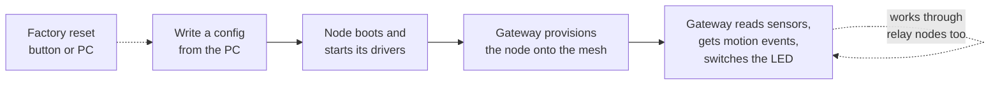

# System overview

## The one-sentence version

Stone Ocean is firmware for small ESP32 boards that read sensors and switch
things on and off, and that talk to each other and to a gateway over Bluetooth
mesh. What each board actually has plugged into it isn't baked into the
firmware: a small JSON file stored on the board says so.

## Why it's built this way

Picture a building with a dozen of these boards. One has a temperature sensor,
one has a motion sensor and a light, one has nothing but sits in the middle of
the hallway passing messages along. You don't want a dozen firmware builds for
that. So there's **one firmware image** for every node, and each node gets its
own **config** that says "you have an SHTC3 on these pins, a PIR on that pin,
an LED over there".

Bluetooth mesh is the network because it needs no Wi-Fi infrastructure, works
over short hops between boards, and any node can relay messages for others.
That means a node too far from the gateway can still be reached through its
neighbours.

## The cast of characters

```
                   ┌──────────────────────────────┐
                   │        Developer's PC        │
                   │                              │
                   │  config_flash.py             │
                   │  (check / write / read /     │
                   │   erase / factory-reset)     │
                   └──────────────┬───────────────┘
                                  │ USB serial (esptool)
                                  │ writes the config straight
                                  │ into the node's flash
                                  ▼
 ┌──────────────┐  BLE mesh  ┌──────────────┐  BLE mesh  ┌──────────────┐
 │    Node B    │◄──────────►│    Node A    │◄──────────►│   Gateway    │
 │  (relay,     │            │  SHTC3, PIR, │            │  Linux +     │
 │   maybe LED) │            │  LED         │            │  BlueZ mesh  │
 └──────┬───────┘            └──────────────┘            └──────┬───────┘
        │                                                       │
        └──────────── messages can hop through B ───────────────┘
```

There are three kinds of things in the system:

1. **Nodes.** ESP32 boards running this firmware. Each one reads its config at
   boot, starts the drivers it needs, joins the mesh and serves its devices to
   whoever asks. Every node also relays mesh traffic for its neighbours.
2. **The config flashing tool.** A Python script on the developer's PC. It
   checks a config file very carefully and then writes it directly into the
   node's flash over USB. The node doesn't run any code to receive it; the
   config just shows up in flash and gets picked up at the next boot.
3. **The gateway.** A Linux machine with a Bluetooth adapter running BlueZ's
   mesh daemon. It adds nodes to the network (provisioning), asks them what
   devices they have, receives their readings and sends on/off commands. For
   now this is a Python script standing in for a future embedded Linux gateway
   (spec 12, not built yet). The bench setup uses a BeagleBone Black.

## What the system can do (v1)



1. **Config flashing.** Validate a JSON config on the PC and write it into the
   node. It takes effect on the next reset, which the write triggers anyway.
2. **Config-driven boot.** The node loads the config and starts the matching
   drivers. If the config is missing or broken, it says why in the log and
   starts no drivers at all (that's *safe mode*).
3. **Mesh provisioning.** The gateway finds the node, gives it network keys and
   an address, and tells it where to publish its readings.
4. **Read and control.** Temperature, humidity and motion flow to the gateway.
   The gateway switches the LED. All of this works across relay hops.
5. **Maintenance.** Factory reset wipes the node back to "no config, not on any
   mesh". A watchdog restarts a hung node, and the node logs why it last reset
   and how many times it has crashed.

## The hardware

The node is a custom board with an ESP32 WROVER module (16 MB flash, 8 MB
PSRAM). It's programmed and logged over USB serial only, there's no JTAG.

```
            ┌───────────────────────────────────────┐
            │          Custom ESP32 board           │
            │                                       │
            │   ┌───────────────┐                   │
            │   │ ESP32 WROVER  │   fixed on board: │
  USB ──────┼──►│ 16MB flash    │   • status LED    │──► GPIO0 (blinks)
  (power,   │   │ 8MB PSRAM     │   • reset button  │◄── GPIO34
  flash,    │   └───────┬───────┘                   │
  log)      │           │  configured by JSON:      │
            │           ├── I2C ──► SHTC3 temp/RH   │
            │           ├── GPIO ◄─ PIR motion      │
            │           └── GPIO ─► LED             │
            └───────────────────────────────────────┘
```

Two parts are **fixed on the board** and known to the firmware without any
config: a status LED that blinks a heartbeat, and a reset button for factory
reset. Everything else (sensors, the switchable LED) is described in the
config, so the pins can change from board to board.

The node runs on USB or mains power, never sleeps, and always acts as a mesh
relay.

## Key design decisions at a glance

These come up again and again in the other pages. Here's the short version so
you know what to look for.

| Decision | Why |
|---|---|
| One firmware, many configs | Hardware differences live in data, not in builds. |
| Config written straight into flash by the PC | The node needs no command interface and no code to receive a config. Less code, less attack surface. |
| Bad config means safe mode, not a crash | A node must survive anything you throw at it, and still be fixable from the PC. |
| Every thread is an *active object* | No shared state between threads, so no locks, no races, and every piece can be tested on a PC. |
| One vendor mesh model, protobuf messages | We control both ends, so one small, evolvable schema beats a pile of Bluetooth SIG models. |
| Fixed mesh composition | Adding a sensor to the config never forces you to re-provision the node. |
| Hardware behind a thin HAL | Drivers and logic run on the PC against fakes, so most bugs are caught without a board. |

## What's out of scope for now

Some things are deliberately left for later: config delivery over the mesh, a
periodic health heartbeat on the mesh, remote reboot or factory reset, air
quality sensors, OTA updates, secure boot and flash encryption, and low-power
operation. The mesh message numbering already leaves room for the mesh-based
ones.
