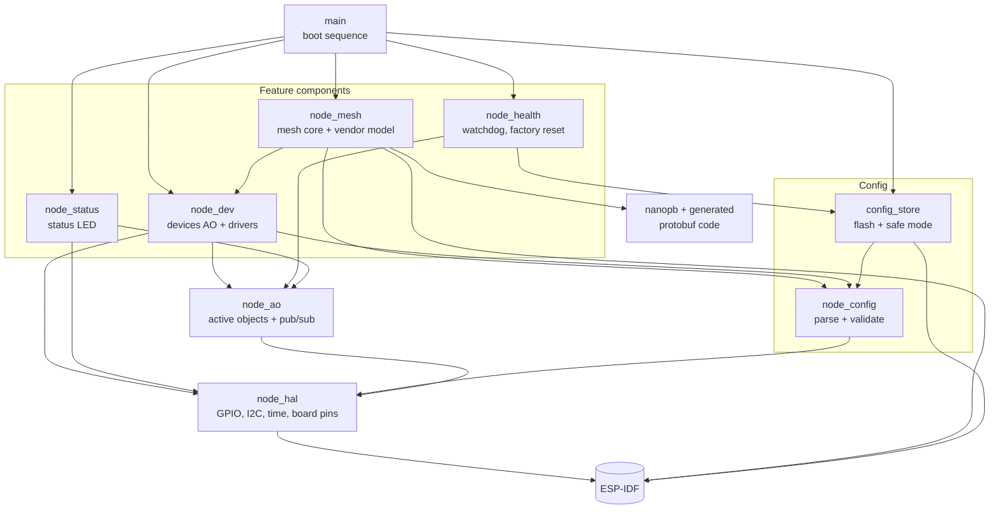

# Firmware architecture

This page zooms into a single node and shows how the firmware is put
together. Think of it as a map: what the big blocks are, what each one is
responsible for, and which way the arrows point.

## The layer cake

```
┌──────────────────────────────────────────────────────────────────┐
│  main: boot sequence (decides what starts, and in which order)   │
├──────────────────────────────────────────────────────────────────┤
│                                                                  │
│   node_mesh          node_dev            node_health  node_status│
│   (BLE mesh +        (devices AO +       (watchdog,   (status    │
│    vendor model)      PIR, LED, SHTC3)    factory      LED       │
│                                           reset)       heartbeat)│
│                                                                  │
├──────────────────────────────────────────────────────────────────┤
│   config_store (flash file, safe mode)   node_config (JSON parse │
│                                           and validation)        │
├──────────────────────────────────────────────────────────────────┤
│   node_ao: active objects, time events, publish/subscribe        │
├──────────────────────────────────────────────────────────────────┤
│   node_hal: GPIO, I2C, time            (board pins live here too)│
├──────────────────────────────────────────────────────────────────┤
│   ESP-IDF: FreeRTOS, ESP-BLE-MESH, LittleFS, NVS, drivers        │
└──────────────────────────────────────────────────────────────────┘
```

Read it from the bottom up:

- **ESP-IDF** is Espressif's SDK. It gives us the RTOS, the Bluetooth mesh
  stack, filesystems and the low-level drivers.
- **`node_hal`** is a deliberately thin wrapper around GPIO, I2C and time.
  It's thin because its only job is to be a *seam*: on the PC, tests swap it
  for a fake that can script I2C replies, inject GPIO edges and move time
  forward on demand.
- **`node_ao`** is the concurrency framework. Every thread in the firmware is
  built on it. It has its own page: [Active objects](03-active-objects.md).
- **`node_config`** turns raw JSON into a validated, fixed-size description of
  the node. **`config_store`** keeps the raw JSON in flash and decides at boot
  whether the node runs normally or in safe mode.
- The **feature components** on top do the actual work: drive devices, talk
  mesh, watch health, blink the status LED.
- **`main`** is tiny. It just runs the boot sequence that starts everything in
  the right order.

## Who depends on whom



A few things worth noticing:

- **The mesh depends on the devices, never the other way round.** The device
  layer has no idea the mesh exists. It just announces "this reading changed"
  and whoever cares listens. You could bolt on a different transport (Wi-Fi,
  a serial protocol) without touching a single driver.
- **The config is the shared language.** Both devices and mesh read the same
  parsed config, and a device's *index* (its position in the config's device
  list) is how they agree on which device is which.
- **`node_health` reaches down to `config_store`** because a factory reset has
  to erase the config. The mesh plugs into factory reset through a hook, so
  health doesn't need to know about mesh at all.

## The components, one line each

| Component | Job |
|---|---|
| `main` | Runs the boot sequence. Owns no logic of its own. |
| `node_hal` | Thin hardware layer for GPIO, I2C and time. Also holds the board's fixed pins. Has a PC fake for tests. |
| `node_ao` | Active objects: private event queues, threads, timers, publish/subscribe. |
| `node_config` | Parses and validates JSON into a fixed-size struct, with precise error messages naming the JSON path. |
| `config_store` | Keeps the raw config in its own flash partition and decides normal vs. safe mode at boot. |
| `node_dev` | The devices AO and its drivers (PIR, LED, SHTC3). Schedules sampling, handles faults, throttles reports. |
| `node_mesh` | Joins the BLE mesh, serves the Stone Ocean vendor model, encodes and decodes protobuf messages. |
| `node_health` | Task watchdog, reset reason, crash counter, factory reset (button and hooks). |
| `node_status` | Blinks the on-board status LED so you can see the app is alive. |
| `nanopb` | Tiny protobuf runtime with no heap. Message code is generated at build time from `proto/`. |

## The threads at runtime

Each feature that needs to "do things over time" gets its own active object,
which is just a thread with a queue. Here are all of them:

```
     ESP-IDF's own tasks                    Our active objects
  ┌────────────────────────┐        ┌──────────────────────────────┐
  │ Bluedroid / BLE mesh   │ posts  │ mesh AO      provisioning    │
  │ (radio, mesh stack)    ├───────►│              events          │
  │                        │        ├──────────────────────────────┤
  │                        ├───────►│ models AO    answers mesh    │
  │                        │        │              requests,       │
  │                        │        │              publishes status│
  ├────────────────────────┤        ├──────────────────────────────┤
  │ GPIO interrupts        ├───────►│ devices AO   runs every      │
  │ (PIR edge, button)     │        │              driver          │
  │                        │        ├──────────────────────────────┤
  │                        ├───────►│ health AO    reset button    │
  │                        │        │              long press      │
  ├────────────────────────┤        ├──────────────────────────────┤
  │ app_main (runs boot,   │        │ status AO    LED heartbeat   │
  │ then returns)          │        ├──────────────────────────────┤
  └────────────────────────┘        │ selftest AO  optional HAL    │
                                    │              bring-up check  │
                                    └──────────────────────────────┘
```

The rule is simple: things that ESP-IDF runs for us (the Bluetooth stack, ISRs)
never do real work. They package up what happened into an event and drop it in
the right AO's queue. The AO does the work in its own time.

## Three ways to build the same firmware

The same source code builds three different ways:

```
                         ┌─────────────────────┐
                         │   firmware source   │
                         └──────────┬──────────┘
            ┌───────────────────────┼───────────────────────┐
            ▼                       ▼                       ▼
  ┌───────────────────┐   ┌───────────────────┐   ┌───────────────────┐
  │   hw flavour      │   │   qemu flavour    │   │   host tests      │
  │                   │   │                   │   │                   │
  │ real ESP32,       │   │ ESP32 emulator,   │   │ your PC's gcc,    │
  │ mesh on           │   │ mesh compiled out │   │ no ESP-IDF at all,│
  │                   │   │ (no BT in QEMU)   │   │ fake HAL + AO port│
  └───────────────────┘   └───────────────────┘   └───────────────────┘
```

That's why public headers are kept free of ESP-IDF includes: the host build
has to compile them with a plain PC compiler. More on how each flavour is used
in [Testing strategy](09-testing-strategy.md).

## Flash layout

The 16 MB flash is split into a handful of partitions. The important thing is
that **config and mesh state live in different partitions**, so you can
rewrite the config without kicking the node off the mesh.

```
 0x9000  ┌──────────────┐
         │ nvs     24K  │  mesh keys + address, crash counter
 0xF000  ├──────────────┤
         │ phy_init 4K  │  radio calibration
 0x10000 ├──────────────┤
         │              │
         │ factory  2MB │  the firmware (about half of it used)
         │              │
         ├──────────────┤
         │ config  64K  │  LittleFS with one file: the JSON config
         ├──────────────┤
         │              │
         │  unused      │  room for OTA slots later
         │              │
         └──────────────┘
```
