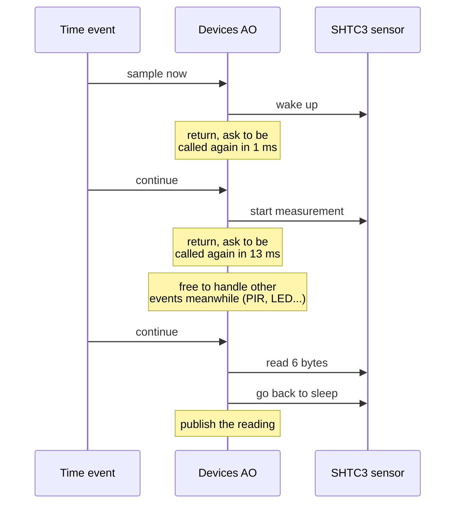
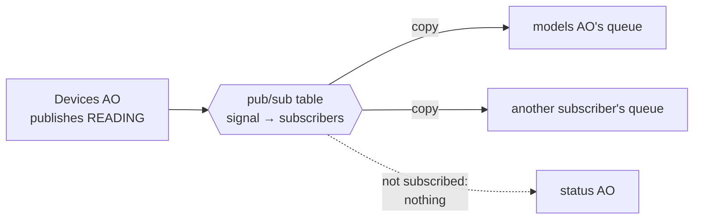

# Active objects

If there's one page to read before touching the firmware, it's this one. The
whole node is built around a single concurrency rule, and once you get it,
the rest of the design makes a lot more sense.

## The rule

> Every thread in the firmware is an **active object**. Threads never share
> state. They only send each other events.

That's it. No mutexes, no shared globals between threads, no "just read the
other module's variable real quick". If one part of the firmware needs
something from another part, it sends a message.

## What's an active object?

An active object (AO) is three things bundled together:

```
            ┌───────────────────────────────────────────┐
            │              Active object                │
            │                                           │
 events ───►│  ┌─────────────────┐     ┌─────────────┐  │
 from       │  │ private queue   │────►│ one thread  │  │
 anywhere   │  │ [e3][e2][e1]    │     │ handles one │  │
            │  └─────────────────┘     │ event at a  │  │
            │                          │ time        │  │
            │  ┌─────────────────┐     │             │  │
            │  │ time events     │────►│ owns its    │  │
            │  │ (its own timers)│     │ own state   │  │
            │  └─────────────────┘     └─────────────┘  │
            └───────────────────────────────────────────┘
```

1. **A private queue.** Anyone can drop an event into it: another AO, a
   callback from the Bluetooth stack, an interrupt handler.
2. **One thread** that takes events out one at a time and handles each one
   completely before looking at the next. This is called *run to completion*.
3. **Time events.** The AO's own timers. When one goes off, it just shows up
   as another event in the queue, handled by the same thread.

The AO's state belongs to its thread alone. Since only one thread ever touches
it, and only one event at a time, there's nothing to lock.

## Run to completion, and why handlers can't wait

Because an AO handles one event at a time, a handler that blocks freezes the
whole AO. So handlers are not allowed to sleep, wait on a queue, or spin.

"But my sensor needs 13 ms to take a measurement!" Fine: split the work into
steps. Start the measurement, arm a time event for 13 ms, and return. When the
time event arrives, read the result.



While the sensor is busy, the devices AO is free to handle a PIR edge or an
LED command. Nothing waits on anything.

(There's one small, deliberate exception: a driver's one-time *init* may wait
for a sub-millisecond device timing. It only happens at start and on retries,
and costs at most a couple of RTOS ticks.)

## How AOs talk to each other

There are exactly two ways, and choosing between them is easy:

```
  ┌─────────────────────────────────────────────────────────────┐
  │  "Do this"  ──► COMMAND, posted straight to the one owner   │
  │                                                             │
  │     models AO ──── set LED on ────► devices AO              │
  │                                                             │
  ├─────────────────────────────────────────────────────────────┤
  │  "This changed" ──► PUBLISHED to whoever subscribed         │
  │                                                             │
  │                         ┌──► models AO  (keeps a copy)      │
  │     devices AO ── new ──┤                                   │
  │                 reading └──► any future subscriber          │
  └─────────────────────────────────────────────────────────────┘
```

- **Commands go direct.** Every resource has exactly one owner AO. If you
  want the LED switched, you post a command to the AO that owns the LED. You
  don't touch the pin yourself.
- **Changes are published.** When an AO's data changes (a new temperature, a
  motion start, a fault) it publishes an event. It has no idea who's
  listening. Subscribers get their own copy of the event in their own queue
  and keep the latest value in their own state.

The consequence: **nobody ever reads another AO's state**. The mesh layer
doesn't ask the devices AO "what's the temperature?". It already knows,
because it's been keeping its own copy from the published readings. When a
mesh request comes in, it answers straight from that copy.

## Publish/subscribe, in a bit more detail



- There's **no broker thread**. Publishing just walks a small table and copies
  the event into each subscriber's queue, right there in the publisher's
  thread.
- Events are **copied by value**. They're small (32 bytes max), so there's no
  memory pool and no reference counting to get wrong.
- **Signals are numbered in blocks.** Each publishing component gets its own
  block of published signal numbers so they never collide. Private signals
  (timers, direct commands) live in a lower range, so they can never be
  mistaken for a published one.
- **Nobody blocks.** If a subscriber's queue is full, *that* subscriber misses
  the event, the publisher logs a warning, and everyone else still gets it.

## Where events come from

Events can enter an AO from a few places, and only the AO's own thread ever
acts on them:

```
  GPIO interrupt (PIR edge) ──┐
                              │  only post an event,
  BLE mesh stack callback ────┤  never do the work
                              │
  another AO ─────────────────┤
                              ▼
                      ┌───────────────┐
  own time events ───►│   AO queue    │──► AO thread does the work
                      └───────────────┘
```

Interrupt handlers and callbacks that ESP-IDF runs in its own tasks are
treated like doorbells: they ring, and that's all. This keeps interrupt
handlers tiny, and it means the Bluetooth stack's task is never held up by our
code.

## The watchdog connection

Every AO thread is registered with the ESP-IDF task watchdog. An AO's thread
wakes up at least once a second even when it has nothing to do, and feeds the
watchdog each time it goes round its loop. So if any handler ever hangs, its
AO stops feeding the watchdog, and about 10 seconds later the node resets and
logs why. See [Health and recovery](08-health-and-recovery.md).

## Why bother? The testing payoff

This design pays off most in testing. On the PC, the AO framework has a second
implementation that has no threads at all. Tests post events, move a fake
clock forward, and then say "run until nothing's left to do". Everything is
synchronous and deterministic.

```
  Real board                         PC test
  ──────────                         ───────
  FreeRTOS queues + threads          plain arrays, no threads
  real millisecond clock             fake clock the test moves forward
  events handled "whenever"          run_until_idle(): handle everything now

        same AO code runs on both, unchanged
```

So you can test "the SHTC3 goes to FAULT after three failed samples and
recovers 30 seconds later" in a few microseconds, without a board, without a
sensor and without waiting 30 seconds.

## What the framework deliberately leaves out

It's intentionally small. No hierarchical state machines (each AO just uses a
`switch` on its state and the event), no dynamic event allocation, no
deferred events, no unsubscribe. Every bit of memory is set up once at start.
If a future feature needs more, it can be added then.
