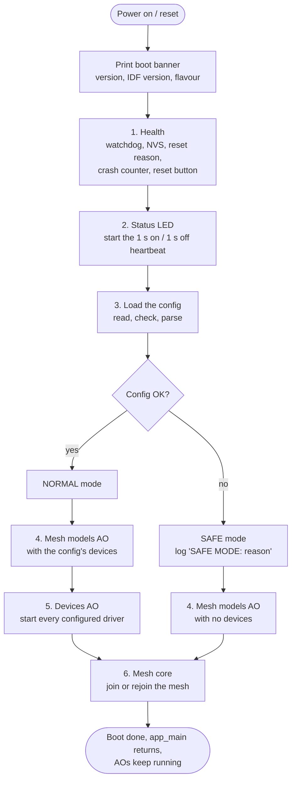
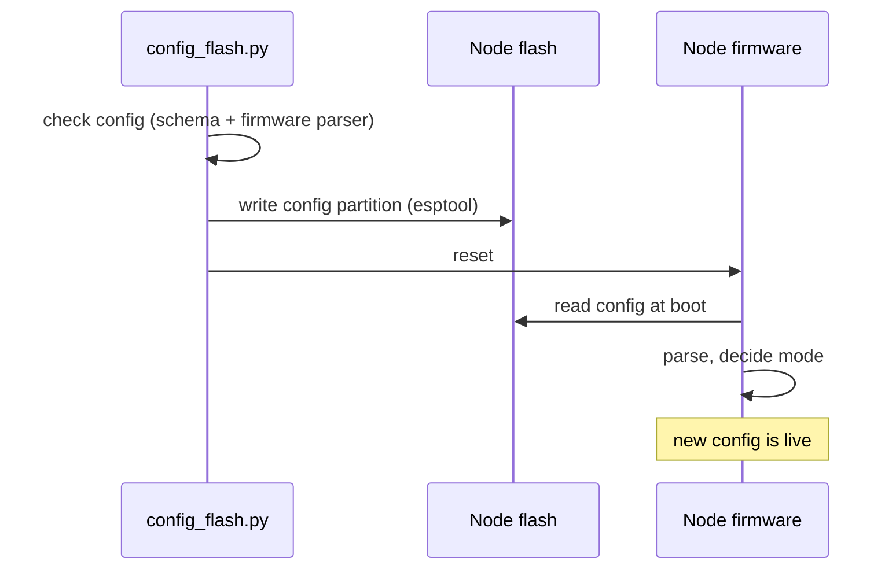

# Boot and modes

This page walks through what a node does from the moment it gets power, and
explains the two modes it can end up in.

## The boot sequence

The order matters here, and each step is placed where it is for a reason.



Why this order?

1. **Health first.** It sets up the watchdog and records the reset reason
   before anything else can go wrong. If a later step crashes the node, the
   next boot still knows about it.
2. **Status LED second, before the config.** The heartbeat should blink no
   matter what, even with a broken config. A blinking LED means "the firmware
   is running", which is the first thing you want to know when a board looks
   dead.
3. **Config next,** because everything after this depends on which mode we're
   in.
4. **Mesh models before devices.** The models AO subscribes to device events.
   If it started after the devices, it would miss each device's very first
   value.
5. **Mesh core last,** because the models AO has to register the vendor model
   before the mesh stack starts. Once the mesh starts, the node's composition
   is fixed.

After the boot sequence, `app_main` simply returns. There's no main loop.
From then on the node is just a set of active objects reacting to events.

## Normal mode vs. safe mode

```
                         ┌──────────────────┐
                         │  config at boot  │
                         └────────┬─────────┘
                ┌─────────────────┴─────────────────┐
            valid                              missing, corrupt
                │                              or invalid
                ▼                                   ▼
   ┌────────────────────────┐          ┌────────────────────────┐
   │      NORMAL mode       │          │       SAFE mode        │
   ├────────────────────────┤          ├────────────────────────┤
   │ ✔ health + watchdog    │          │ ✔ health + watchdog    │
   │ ✔ status LED heartbeat │          │ ✔ status LED heartbeat │
   │ ✔ mesh (if provisioned │          │ ✔ mesh (if provisioned │
   │   or waiting to be)    │          │   or waiting to be)    │
   │ ✔ drivers running      │          │ ✘ no drivers           │
   │ ✔ device list on mesh  │          │ ✘ empty device list    │
   └────────────────────────┘          └────────────────────────┘
```

**Safe mode** is the node's "I'm fine, but I don't know what I'm supposed to
do" state. It happens when:

- no config is stored (a fresh board, or right after a factory reset),
- the stored config is corrupt (bad header, bad checksum),
- the config is readable but invalid (say, it puts an LED on a flash pin).

The node logs the reason exactly once, at error level, for example:

```
SAFE MODE: no config stored
SAFE MODE: stored config is corrupt
SAFE MODE: devices[1].gpio: GPIO 0 is used by the status LED
```

The important bit is what safe mode *doesn't* do: it doesn't crash, it doesn't
reboot in a loop, and it doesn't touch any of the configured pins. A bad
config can't drive a pin it shouldn't. And the node stays fixable: just write
a good config from the PC and it boots normally.

The mesh still runs in safe mode, with exactly the same composition as in
normal mode. It just reports an empty device list. That way a provisioned
node never falls off the network because of a config mistake.

## When does a new config take effect?

Only at the next boot. There's no hot reload. In practice you never notice,
because writing a config from the PC resets the node anyway.



## What survives a reboot

| Thing | Where it lives | Survives reboot | Survives config write | Survives factory reset |
|---|---|---|---|---|
| Config | `config` partition | ✔ | replaced | ✘ |
| Mesh membership (keys, address) | `nvs` partition | ✔ | ✔ | ✘ |
| Crash counter | `nvs` partition | ✔ | ✔ | ✘ (cleared) |
| Device readings | RAM | ✘ | ✘ | ✘ |
| Device UUID | derived from the MAC | ✔ | ✔ | ✔ |

The split between the `config` and `nvs` partitions is what makes the middle
column work: changing what's plugged into a node never forces you to add it to
the mesh again.
