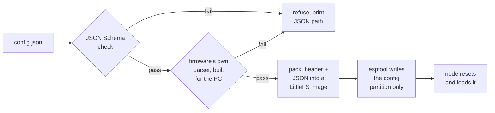

# Configuration

The config is the heart of the "one firmware, many nodes" idea. This page
covers what's in it, how it gets onto a node, how it's stored, and the
layers of checking that keep a bad config from causing trouble.

## What a config describes

A config is a small JSON file (4 KB max) that answers three questions:

```
  ┌───────────────────────────────────────────────────────┐
  │  Who am I?          node_name: "lab-node-1"           │
  ├───────────────────────────────────────────────────────┤
  │  What buses do I    i2c0: port 0, SDA 21, SCL 22,     │
  │  have?                    100 kHz                     │
  ├───────────────────────────────────────────────────────┤
  │  What's plugged     [0] env1  shtc3  on i2c0          │
  │  in?                    sample every 10 s, report on  │
  │                         0.5 °C / 2 %RH change         │
  │                     [1] pir1  pir    on GPIO 27       │
  │                     [2] led1  led    on GPIO 25       │
  └───────────────────────────────────────────────────────┘
```

The position of each device in the list is its **device index**. That number
is how the device layer and the mesh agree on which device is which, and it's
what the gateway uses when it asks for a reading or sends a command. So the
order of devices in the config matters.

Sensors also carry their own timing: how often to sample, and when a change is
worth reporting (see [Devices](06-devices.md) for the reporting rules). If you
leave optional fields out, sensible defaults are filled in.

Example configs live in [`configs/`](../configs/), along with the JSON Schema.

## How a config gets onto a node

There's no command interface on the node. It doesn't listen for configs on
the serial port, and it doesn't (yet) accept them over the mesh. Instead, the
PC tool writes the config **straight into the node's flash**, as if it had
always been there.



The interesting part is the **double check**. The JSON Schema catches most
mistakes (wrong types, missing fields, out-of-range numbers). But some rules
are easier to express in code, like "no two devices on the same pin". So the
tool also compiles the *firmware's actual parser* as a PC program and runs it
on the file. If the firmware would reject the config, the PC tool rejects it
first, with the same error message.

That means a bad config is never written. And if one somehow gets there anyway
(an older tool, a corrupted flash), the node itself rejects it at boot and
goes into safe mode.

```
  Three layers of defence
  ───────────────────────
  1. JSON Schema      on the PC   catches shape and range mistakes
  2. firmware parser  on the PC   catches every rule the node enforces
  3. firmware parser  on the node catches anything that slipped through
                                  → safe mode, never a crash
```

The tool also works on QEMU's flash image file instead of a serial port, so
the whole flow can be tested without hardware.

The tool's subcommands, briefly:

| Subcommand | What it does |
|---|---|
| `check` | Run both checks. Touches no node. |
| `write` | Check, then write the config and reset the node. |
| `read` | Read the stored config back, exactly as written. |
| `erase` | Remove the config. Next boot: safe mode. |
| `factory-reset` | Erase the config *and* mesh state. See [Health and recovery](08-health-and-recovery.md). |

Writing touches only the `config` partition. The mesh keys in `nvs` stay put,
so a node keeps its place on the mesh across config changes.

## How it's stored

The config partition holds a tiny LittleFS filesystem with a single file. The
file is a 16-byte header followed by the raw JSON:

```
  config.bin
  ┌──────────┬──────────┬──────────┬──────────┬───────────────────────┐
  │  magic   │ format   │  JSON    │  CRC32   │  raw JSON text ...    │
  │ "NCFG"   │ version  │  length  │ of JSON  │                       │
  └──────────┴──────────┴──────────┴──────────┴───────────────────────┘
    4 bytes    4 bytes    4 bytes    4 bytes     up to 4096 bytes
```

Why store the raw JSON rather than the parsed result?

- You can read it back **exactly** as you wrote it.
- The parsed format inside the firmware can change between versions without
  breaking stored configs.

The header lets the node tell "no config" apart from "garbage in flash": a
bad magic, unknown version, wrong length or checksum mismatch all mean
*corrupt*, which means safe mode.

When the firmware itself saves a config (not used yet, but planned for config
over the mesh), it writes a temporary file and renames it over the old one.
LittleFS renames atomically, so a power cut mid-save leaves either the old
config or the new one, never half of each.

## What the validator checks

You don't need the full list to understand the system, but these are the
kinds of mistakes it catches:

- **Structure:** right version, required fields present, right types,
  values in range, IDs unique and short enough, no more than 8 devices and 2
  I2C buses.
- **References:** a device's bus must actually exist.
- **Pins:** no pin used twice, and no pin the board can't spare:

```
  ESP32 pins the validator protects
  ─────────────────────────────────
  GPIO 0       status LED (fixed on the board)
  GPIO 1, 3    serial port (flashing and log)
  GPIO 6–11    connected to the flash chip
  GPIO 16, 17  PSRAM on the WROVER module
  GPIO 34      reset button (fixed on the board)
  GPIO 34–39   input only: no outputs, no internal pulls
  GPIO 2,5,12,15  allowed, but you get a warning (strapping pins)
```

Every error names the exact spot in the JSON, like `devices[1].gpio`, so you
know what to fix without guessing. Unknown keys get a warning but don't fail
the config, which leaves room for adding fields later.

The board's fixed pins (status LED and reset button) are defined in one
header that both the firmware and the PC checker read. So the two can never
disagree about which pins are taken.
