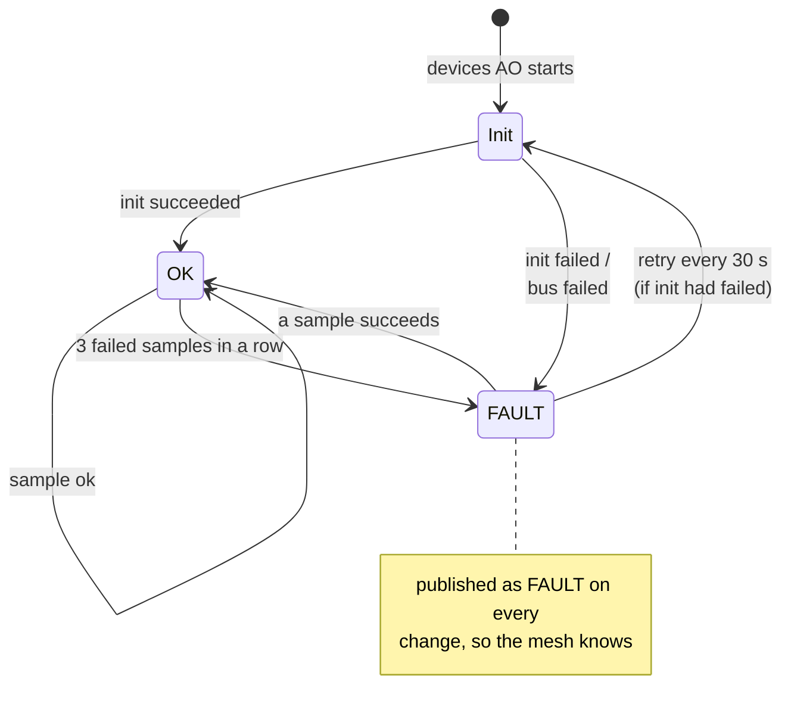
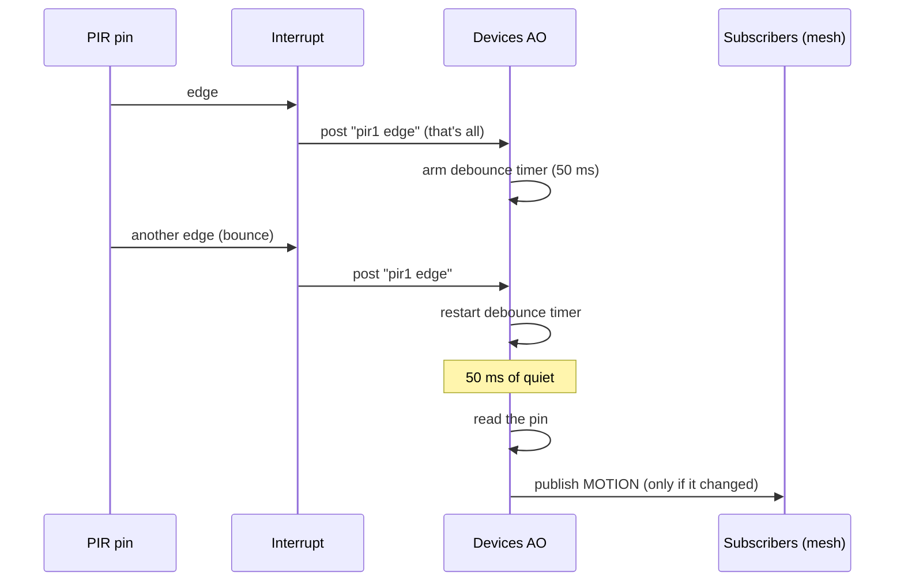

# Devices

This page is about the part of the node that actually touches the physical
world: sensors and actuators. All of it lives in one active object, the
**devices AO**.

## One AO, many devices

Every configured device is owned by the devices AO. There isn't one thread per
sensor. One thread runs every driver, and a single timer is always set to
whatever deadline comes next (the next sample, the next retry, the end of a
debounce wait).

```
                       ┌───────────────────────────────────┐
                       │            Devices AO             │
  PIR interrupt ──────►│                                   │
                       │   [0] env1  SHTC3   ok            │
  "set LED on" ───────►│   [1] pir1  PIR     ok            │──► published:
  (from the mesh)      │   [2] led1  LED     ok            │    READING
                       │                                   │    MOTION
  one timer, armed ───►│   each slot: driver + state +     │    ONOFF_CHANGED
  for the earliest     │   schedule + last published value │    FAULT
  deadline             │                                   │
                       └──────────────┬────────────────────┘
                                      │ HAL only
                                      ▼
                               GPIO / I2C pins
```

Why one AO for everything? Devices are cheap to service, and keeping them on
one thread means they can share I2C buses without any locking. It also keeps
RAM use predictable: everything is sized up front for at most 8 devices.

## Drivers are plugins

Each device type (SHTC3, PIR, LED) is a **driver**: a small set of functions
the framework calls. Drivers register by type before the devices AO starts,
and then the framework creates one instance per config entry.

A driver can do up to four things:

| Hook | Who uses it | What it's for |
|---|---|---|
| init | everyone | Set up the device. Called at start, and again on retries. |
| sample | sensors (and the LED, to report its state) | Read the current value. May say "not ready yet, call me again in N ms". |
| set on/off | actuators | Switch something. |
| on interrupt | event-driven sensors (PIR) | Say "sample me again after N ms" (for debouncing). |

The framework handles all the boring, shared stuff: scheduling, retries,
fault tracking, report throttling and publishing. A driver only knows how to
talk to its own chip.

Drivers only use the HAL, never ESP-IDF directly. That's what lets every
driver run on the PC against a fake I2C bus and fake GPIO.

## A device's life: ok and FAULT

Devices fail. Wires come loose, sensors die. The rule is that **one bad device
never takes down the others**.



- If a device can't initialise (say, the SHTC3 doesn't answer), it's marked
  FAULT and retried every 30 seconds. Its I2C bus is re-initialised first if
  that's what failed.
- If a working device fails three samples in a row, it's marked FAULT but
  keeps being sampled on schedule. The first good sample brings it back.
- A device whose type has no driver at all is marked FAULT for good.
- Every switch between ok and FAULT is published, and logged.

## When is a reading worth reporting?

A sensor might be sampled every few seconds, but nobody wants a mesh message
for every sample when the room temperature hasn't changed. So readings go
through a reporting policy:

```
  A new sample comes in.  Publish it if:

    ① it's the first good sample since start          → always
    ② it changed enough   AND   min interval passed   → "something happened"
    ③ max interval passed since the last report       → "still alive" heartbeat

  "Changed enough" is measured against the last value that was
  PUBLISHED, not the last one sampled, so slow drift still adds up.
```

Here's how that plays out over time with, say, a 5 s minimum and 60 s
maximum:

```
 time ──────────────────────────────────────────────────────────────►
 samples  ●    ●    ●    ●    ●    ●    ●    ●  ...  ●    ●    ●
 change   -   tiny tiny BIG  tiny tiny tiny          tiny tiny
 report   ▲              ▲                                ▲
          │              │                                │
       first        big change,                     60 s since the
       sample       5 s gap passed                  last report
```

Motion and on/off are simpler: they're published whenever the value
*changes*, and the first value after start is always published so listeners
learn the starting state.

## The three drivers

### PIR (motion)

The PIR is event driven. It doesn't get polled. An edge on its pin wakes
things up, and debouncing happens in the AO, not in the interrupt.



Lots of edges in quick succession become at most one motion event.

### LED (actuator)

The LED is a plain on/off output. It starts in the state the config asks for,
and anyone can ask the devices AO to switch it. Switching it to the state it's
already in does nothing and publishes nothing. Polarity (active high or low)
comes from the config, so callers only ever say "on" or "off".

Don't confuse this LED with the **status LED** on the board. That one belongs
to the status AO, blinks a heartbeat, and isn't a device at all.

### SHTC3 (temperature and humidity)

The SHTC3 is an I2C sensor that needs a little ceremony for each reading. The
driver splits it into non-blocking steps (see the sequence diagram on the
[Active objects](03-active-objects.md) page): wake up, start measuring, wait
13 ms, read, check the checksums, go back to sleep. The sensor sleeps between
measurements.

Every reading comes with checksums from the sensor. A bad checksum is treated
as a failed sample. **A value with a bad checksum is never reported.**

## Commands come in, events go out

From the outside, the devices AO is a black box with a very small surface:

```
           in                                     out
  ─────────────────────               ─────────────────────────────
  "set device N on/off"  ──►  ┌────┐  ──►  READING  (throttled)
   (posted by anyone)         │ AO │  ──►  MOTION   (on change)
                              └────┘  ──►  ONOFF_CHANGED (on change)
  interrupt from device N ──►         ──►  FAULT    (on change)
```

Nobody reads its internal state. Anything that cares about device values
subscribes to these events and keeps its own copy. Today that's the mesh
models AO; tomorrow it could be anything else.
