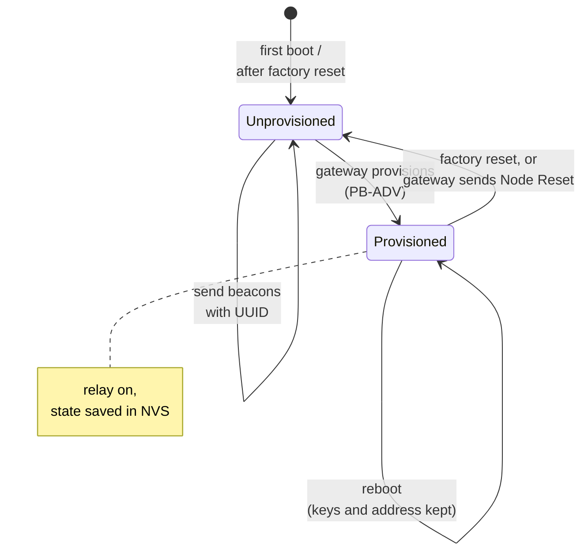
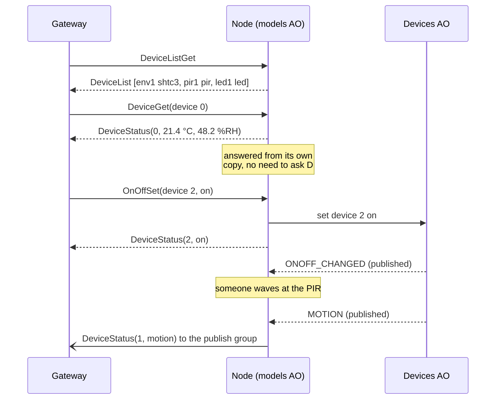

# Mesh networking

This page explains how a node joins the Bluetooth mesh and how the outside
world talks to its devices. If you're new to BLE mesh, there's a short primer
first.

## BLE mesh in two minutes

Bluetooth mesh turns a bunch of Bluetooth devices into one network where any
node can pass messages along for any other. A few terms you'll see a lot:

```
  ┌───────────────────────────────────────────────────────────────┐
  │ Provisioning   Adding a device to the network. The gateway    │
  │                gives it the network key and a unicast address.│
  │                Before this, the device just "beacons": it     │
  │                shouts "I'm here, add me" with its UUID.       │
  ├───────────────────────────────────────────────────────────────┤
  │ Relay          A node that re-broadcasts messages so they     │
  │                reach nodes out of the sender's direct range.  │
  ├───────────────────────────────────────────────────────────────┤
  │ Element        An addressable part of a node. Ours have one.  │
  ├───────────────────────────────────────────────────────────────┤
  │ Model          A "service" on an element that understands     │
  │                certain messages. Standard ones exist (sensor, │
  │                on/off). Vendors can define their own.         │
  ├───────────────────────────────────────────────────────────────┤
  │ Composition    The list of a node's elements and models. The  │
  │                gateway reads it right after provisioning.     │
  ├───────────────────────────────────────────────────────────────┤
  │ Publish        A model sending messages to an address (often  │
  │                a group) without being asked.                  │
  └───────────────────────────────────────────────────────────────┘
```

## Joining the mesh



A few details that matter:

- **Stable identity.** Each node's 16-byte UUID is the text `stoneocean`
  followed by its Bluetooth MAC address. It's the same across reboots and
  factory resets, so the gateway can always recognise a board.
- **Provisioning over advertising (PB-ADV) only.** That's what BlueZ's mesh
  daemon uses. Provisioning over a GATT connection (what phone apps usually
  use) is turned off.
- **Membership survives reboots.** The keys and address are stored in the
  `nvs` partition. A rebooted node picks up right where it left off.
- **Every node relays.** They're all mains powered, so there's no reason not
  to. That's what lets messages hop through Node B to reach Node A.
- **Mesh runs in safe mode too.** A node with a bad config is still on the
  network.

## The big decision: one vendor model

Bluetooth mesh has standard models for sensors and switches. We don't use
them. Instead, every node has exactly one custom model, the **Stone Ocean Node
Server**, and every device on the node is reached through it.

```
   What we could have done             What we do
   ───────────────────────             ──────────
   element 0: config, health           element 0: config server
   element 1: Sensor Server (SHTC3)               health server
   element 2: Sensor Server (PIR)                 Stone Ocean Node Server
   element 3: Generic OnOff (LED)                   └─ devices [0] [1] [2]
                                                       addressed by index
   composition changes whenever
   the config changes                  composition never changes
   → must re-provision                 → never re-provision for config
```

Why?

- **We own both ends.** Nodes are only ever managed by our own tools, so
  interoperability with off-the-shelf mesh controllers isn't worth much.
- **The composition is fixed.** Mesh composition is meant to be static, and
  changing it normally means re-provisioning. With one model on one element,
  the composition is identical whatever the config says. Add a sensor, write
  the new config, reboot: the node stays on the mesh and the gateway just asks
  for the new device list.
- **One schema to rule them all.** Messages are Protocol Buffers defined in a
  single `.proto` file. The firmware and the gateway both generate their code
  from it. Adding a field later is easy and doesn't break older nodes or
  gateways.

The model uses Espressif's company ID (`0x02E5`) for now, until Stone Ocean
has its own. The gateway side uses a matching client model.

## The messages

Each message type gets its own opcode. The payload is just the protobuf
encoding of that message. There's no extra framing.

| Message | Direction | What it means | Answer |
|---|---|---|---|
| `DeviceListGet` | gateway → node | "What devices do you have?" | `DeviceList` |
| `DeviceList` | node → gateway | Type and id of every device, in index order | — |
| `DeviceGet` | gateway → node | "Give me the status of device N" (or all of them) | one `DeviceStatus` per device |
| `DeviceStatus` | node → gateway | Current value and fault flag of one device | — |
| `OnOffSet` | gateway → node | "Switch device N on/off, and tell me" | `DeviceStatus` |
| `OnOffSetUnack` | gateway → node | Same, but don't bother replying | none |

Opcodes up to `0x3F` are reserved for later: a periodic system-info
heartbeat, node commands (reboot, factory reset, identify), config delivery
over the mesh, and OTA.

A typical conversation:



### What a status says, and what it doesn't

A `DeviceStatus` only carries the fields that make sense for that device:
temperature and humidity for an SHTC3, motion for a PIR, on/off for an LED.

The most important rule: **absent means unknown, never stale**. If a device is
in FAULT, or hasn't produced a value yet, its status carries no value fields
at all (just the fault flag, if it's faulted). The gateway will never see an
old reading dressed up as a current one.

The node sends no timestamps. It has no wall clock, so the gateway stamps
messages when they arrive.

### Fitting in one radio packet

Mesh messages small enough to fit in a single packet go out faster and more
reliably. That leaves just **8 bytes** of payload after the opcode. The
schema is designed so every request and every `DeviceStatus` fits:

```
  DeviceStatus for an SHTC3 (the biggest one), 8 bytes:

  ┌────────┬──────────────────┬──────────────────┐
  │ device │ temperature      │ humidity         │
  │ index  │ in 0.1 °C        │ in 0.1 %RH       │
  └────────┴──────────────────┴──────────────────┘

  Values are whole numbers of tenths, rounded and clamped to the
  sensor's range, so they always encode to a known size.
```

Only `DeviceList` is allowed to be bigger (up to about 170 bytes for 8
devices). The mesh splits it into segments, which is fine for a message the
gateway asks for once in a while. Incoming requests bigger than 8 bytes are
dropped.

## Inside the node: three layers

The mesh side of the firmware is split so that as much of it as possible runs
on the PC in tests:

```
  ┌────────────────────────────────────────────────────────────┐
  │ Mesh stack glue (ESP-BLE-MESH)                             │
  │   vendor model registration, the stack's callback,         │
  │   send and publish. The callback just copies the request   │
  │   into an event and posts it. Not testable on the PC.      │
  ├────────────────────────────────────────────────────────────┤
  │ Models AO                                                  │
  │   subscribes to device events, keeps the latest value and  │
  │   fault state per device, answers requests, decides what   │
  │   to publish, forwards on/off commands. No ESP-IDF here,   │
  │   so it's fully tested on the PC.                          │
  ├────────────────────────────────────────────────────────────┤
  │ Message codec                                              │
  │   protobuf encode/decode on nanopb. Pure functions,        │
  │   checked against shared byte vectors.                     │
  └────────────────────────────────────────────────────────────┘
```

Separately, a small **mesh AO** handles provisioning events (provisioned,
reset by the gateway, and so on) and logs them.

## Publishing

Once the gateway has given the vendor model a publish address (usually a
group like `0xC000`), the node pushes a `DeviceStatus` out by itself when:

- a sensor reading passes the reporting policy (see [Devices](06-devices.md)),
- motion starts or stops (immediately),
- an actuator switches, whatever switched it,
- a device enters or leaves FAULT.

No publish address configured? Then nothing gets published. Nothing is ever
sent before the node is provisioned.

## The gateway side

The gateway (spec 12, not built yet) is a Python tool on a Linux machine
talking to BlueZ's `bluetooth-meshd` over D-Bus. The plan:

```
  ┌───────────────────── Linux gateway ─────────────────────┐
  │                                                         │
  │  python -m gateway  init | scan | provision | devices | │
  │                     get | set | listen | remove         │
  │        │                                                │
  │        │ D-Bus (org.bluez.mesh)                         │
  │        ▼                                                │
  │  bluetooth-meshd ── owns a dedicated BT adapter ────────┼──► mesh
  │                                                         │
  │  ~/.config/stone-ocean-gateway/state.json               │
  │  (network token, known nodes and their device lists)    │
  └─────────────────────────────────────────────────────────┘
```

When it provisions a node, it will also check the node has the Stone Ocean
model, bind the app key to it, set its publish group, and fetch its device
list, all in one go. It uses the same `.proto` file and the same byte vectors
as the firmware, so both ends are tested against identical expectations.
Since the real embedded gateway will most likely run BlueZ too, this code is
meant to carry over.
