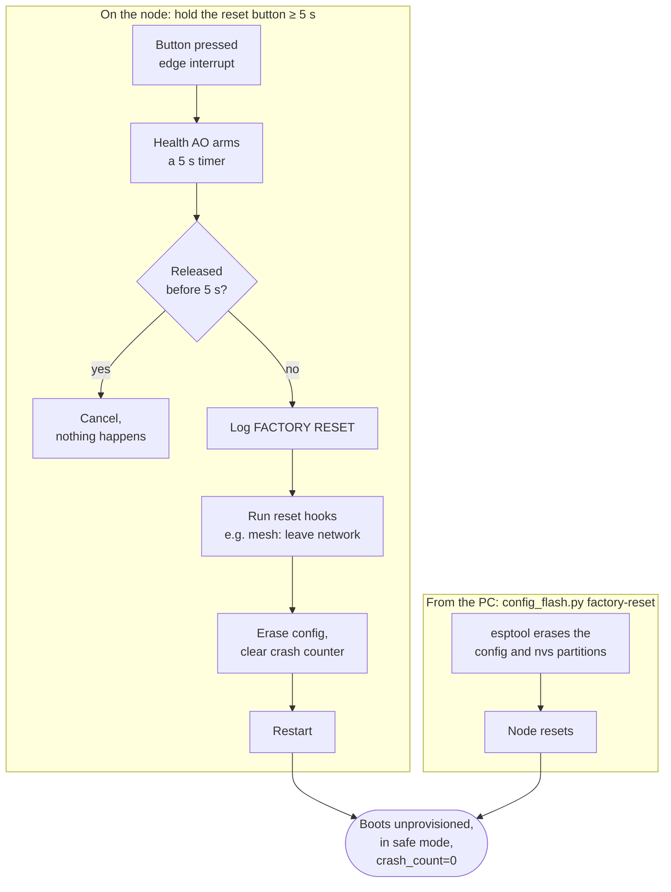

# Health and recovery

The node is meant to run unattended for a long time. This page covers the
features that keep it running, explain what went wrong when it didn't, and
let you wipe it clean when you need to.

## The watchdog: catching hangs

Every active object thread is registered with the ESP-IDF task watchdog. Each
AO's loop wakes up at least once a second, even when idle, and feeds the
watchdog as it goes round.

```
  healthy AO                              hung AO
  ──────────                              ───────
  loop: wait ≤ 1 s → feed → handle →      loop: handle ... stuck forever
        wait ≤ 1 s → feed → handle →            (never comes back round
        ...                                      to feed the watchdog)

  watchdog: 😌                            watchdog: 10 s pass → panic →
                                                    reset → next boot logs
                                                    reset_reason=task_wdt
```

Because the feeding is built into the AO framework itself, every AO gets this
protection for free. No component has to remember to do it.

There's a debug build option that deliberately hangs the health AO 15 seconds
after boot, so you can prove the watchdog works. It's off in every normal
build, and a test checks that it stays off.

## Reset reason and crash counter

Early in every boot, the node logs one line:

```
reset_reason=task_wdt crash_count=1
```

- **Reset reason** is why the chip last reset: power on, software restart,
  panic, watchdog, brownout and so on.
- **Crash counter** goes up by one every time the reason was a crash (panic,
  either watchdog, or brownout). It's stored in NVS, so it survives reboots.

There's no command interface, so the log is the node's way of reporting its
health. Later, this information is meant to go out over the mesh as a
periodic heartbeat.

The health component also sets up NVS (the key-value storage the mesh stack
uses). If NVS is unreadable, which only happens after a partition layout or
ESP-IDF version change, it's erased and recreated. That wipes mesh
membership, but it's better than a node that can't boot.

## Factory reset

Factory reset takes the node back to "fresh out of the box": no config, not
on any mesh, crash counter at zero. There are two ways to trigger it.



Some details:

- **The button counts only presses that start after boot.** If you power up
  with the button already held, it's ignored. That avoids surprise wipes.
- **Long-press detection uses an interrupt plus a timer,** not a busy loop.
  Contact bounce is ignored.
- **Reset hooks** let other components clean up their own state without
  health knowing about them. The mesh registers a hook that removes the node
  from the network. More hooks can be added later.
- **The PC route skips the hooks.** It just erases both partitions directly,
  which has the same end result. It's the fallback when you can't reach the
  button, and it works on QEMU flash images too.

## The status LED: "is it alive?"

The board has a status LED on GPIO0 that blinks **1 second on, 1 second
off** from early in boot, for as long as the firmware runs, in both normal and
safe mode. Nothing changes the pattern.

```
   on  ┌───┐   ┌───┐   ┌───┐   ┌───┐
       │   │   │   │   │   │   │   │      steady heartbeat:
   off ┘   └───┘   └───┘   └───┘   └───   the app is running
       0s  1s  2s  3s  4s  5s  6s  7s
```

It's deliberately simple: if it blinks, the app is up. If it doesn't, either
the firmware isn't running or something went very wrong early in boot.

Why give the status LED its own AO, rather than make it a device?

- It's part of the **board**, not the config. It exists on every node,
  whatever's plugged in.
- It has to work **before the config is loaded**, and in safe mode, when the
  devices AO isn't running.
- It must **never** show up on the mesh or be switchable by the gateway.

A note on GPIO0: it's a strapping pin, and holding it low at reset puts the
chip in download mode. The LED is wired so it never pulls the pin low at
reset, and the pin stays an input with a pull-up until the status AO takes
over. So the board always boots normally.

## How they fit together

```
                   ┌──────────────────────────────────────────┐
                   │                 Node                     │
                   │                                          │
  hang anywhere ──►│ task watchdog ── 10 s ──► reset          │
                   │                            │             │
                   │ boot: reset_reason + crash_count ◄───────┘
                   │                                          │
  button ≥ 5 s ───►│ health AO ── hooks ── erase ──► reset    │
                   │                                          │
                   │ status AO ── heartbeat blink, always     │
                   └──────────────────────────────────────────┘
  PC factory-reset ─── erases config + nvs from outside ──────►
```

Together these cover the "must survive bad configs and unexpected resets"
requirement: a bad config gives safe mode, a hang gives a reset with a logged
reason, and anything else can be fixed with a factory reset from either the
button or the PC.
