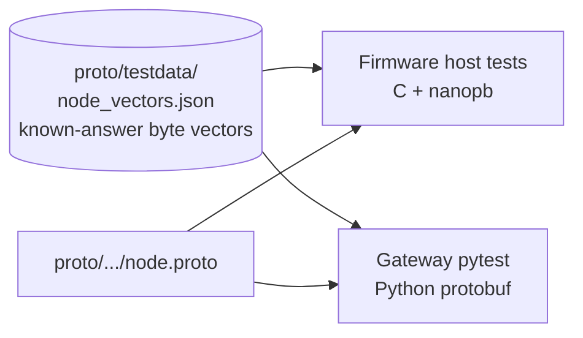

# Testing strategy

Embedded firmware is notoriously painful to test, because so much of it needs
real hardware. The architecture on the other pages is shaped largely by one
goal: **test as much as possible on a normal PC, and save the hardware for
what truly needs it**.

## Three tiers

```
            ▲ slow, manual,                ┌─────────────────────────┐
            │ needs a bench                │   Real hardware         │
            │                              │   BLE mesh, real        │
            │                              │   sensors, relay hops   │
            │                       ┌──────┴─────────────────────────┴──────┐
            │                       │   QEMU (emulated ESP32)               │
            │                       │   boot, config storage and flashing,  │
            │                       │   safe mode, watchdog, factory reset  │
            │              ┌────────┴───────────────────────────────────────┴────────┐
            │              │   Host tests (your PC, plain gcc)                       │
            │              │   parsing, validation, every AO, every driver, the      │
            ▼ fast, CI,    │   reporting policy, message encoding, PC tools          │
              every push   └─────────────────────────────────────────────────────────┘
```

The base of the pyramid is by far the biggest, and it runs on every push.

### Host tests

The firmware's logic is compiled with the PC's own compiler and run as normal
programs, with no ESP-IDF at all. This works because of two seams:

```
     real firmware                      host tests
     ─────────────                      ──────────
     drivers / AOs  ──────── same code ────────  drivers / AOs
          │                                          │
     node_hal (ESP-IDF)                  fake HAL: scripted I2C replies,
                                         injected GPIO edges, fake clock
          │                                          │
     node_ao (FreeRTOS)                  fake AO port: no threads,
                                         "run until idle" on demand
```

- **The fake HAL** lets a test say "when the driver writes these bytes, reply
  with those bytes", "the PIR pin just went high", or "30 seconds have now
  passed". It also checks that the driver did exactly the bus traffic
  expected, in order.
- **The fake AO port** runs every active object synchronously. A test posts
  events, moves the clock, runs until nothing's left, and checks what
  happened. No threads means no flaky timing.

All host tests run under address, leak and undefined-behaviour sanitizers.
Several components were also checked with deliberate "mutations" (break the
code on purpose, make sure a test fails), to be sure the tests actually catch
real bugs.

The PC tools (config flashing) have their own pytest suite with fake esptool
runs and real LittleFS images in temp files.

### QEMU

Espressif's QEMU emulates an ESP32 well enough to boot the real firmware, but
not Bluetooth. So there's a QEMU build flavour with the mesh compiled out. It's
used to check the things that need real flash and a real boot:

- a fresh image boots into safe mode,
- a config written into the flash image boots into normal mode,
- a factory reset on the image gives safe mode again,
- a debug hang build gets reset by the watchdog and counts the crash.

The config flashing tool can write directly to QEMU's flash image file, which
is what makes these flows testable without a board.

### Real hardware

Some things only real hardware can show: the radio and BLE mesh, the actual
SHTC3 and PIR, and messages relaying through a second node. These are
checked on the bench, with the custom board and a BeagleBone Black running
BlueZ as the gateway.

## Both ends test against the same bytes

The node encodes protobuf with nanopb in C. The gateway will decode it with
Python's protobuf library. How do you make sure they agree?



Both test suites check their encoders and decoders against the **same file of
known byte sequences**. Those bytes were computed independently of nanopb, so
a bug in the generated code can't hide by agreeing with itself. If either
side drifts from the schema, its tests fail.

The same idea is used for config validation: the PC tool runs the firmware's
actual parser, so "valid on the PC" and "valid on the node" mean the same
thing.

## Continuous integration

Every push and pull request runs, in the pinned `espressif/idf:v5.4.4`
container:

```
  ┌───────────────────────────┐   ┌───────────────────────────┐
  │ host unit tests           │   │ hardware firmware build   │
  │ config schema checks      │   │ size report               │
  │ formatting check          │   │                           │
  │ PC tool tests             │   │                           │
  │ firmware parser on the    │   │                           │
  │ example configs           │   │                           │
  └───────────────────────────┘   └───────────────────────────┘
```

Any failure fails the build.

## Coming next: system tests

A later chunk (not built yet) adds an end-to-end suite that drives everything
through the real tools:

- **QEMU tests in CI:** the safe mode, config write, factory reset and watchdog
  flows above, automated.
- **Bench tests** with two boards and the gateway: provision both nodes, read
  the SHTC3 and compare with the node's log, switch the LED, wait for
  periodic reports, reboot and check the node is still provisioned, and send
  messages through the second node as a relay.
- **Manual tests** for things a script can't do, like waving at the PIR.

For how individual tests are named and structured, see the
[unit testing standards](unit-testing-standards.md).
